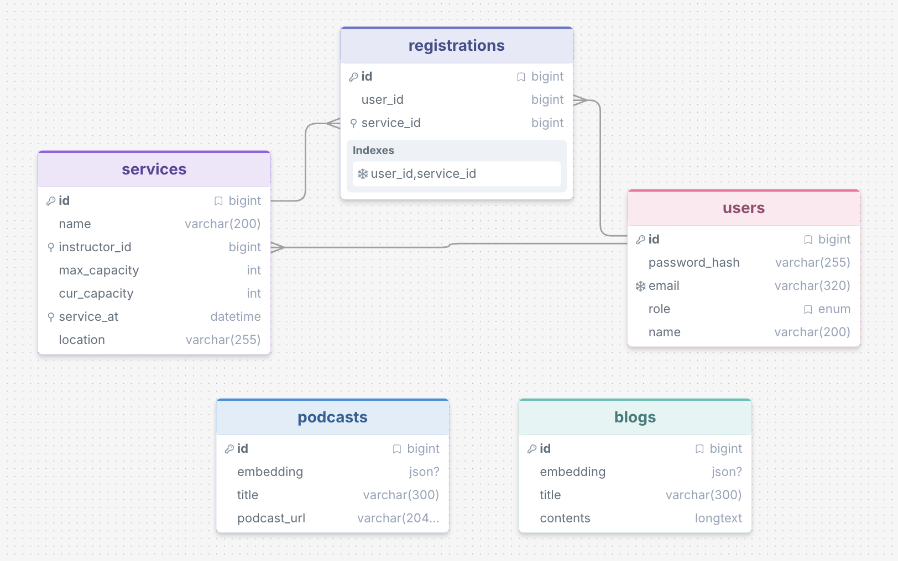
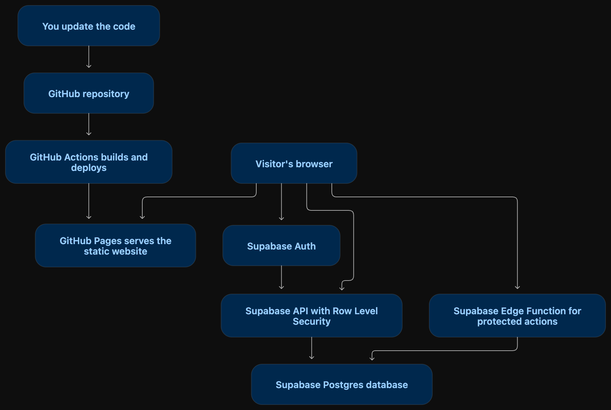
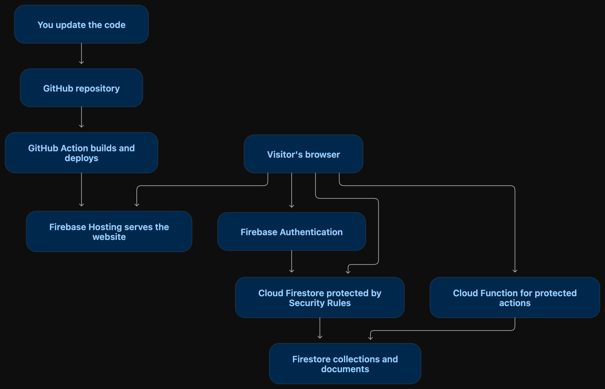

# Living Dawn Website

## Summary

The purpose of this project is to help my wife by building a website to promote her buisness. My goal is to create a functional website that both shares the information that my wife would like to share, attract customers, and promote events that my wife is holding to get others to come and attend.

## ERD sketch

## System Design

For my System Design, I still need to figure out if I want to use Firebase or not. The first diagram is my origianl idea, and the second diagram is the system design if I used Firebase instead

## Daily Goals

Since I am presenting on December 9th (If I am not mistaken), that means I have 21 days from the time I am writting this README.md file on November 18th. This means that I want to put in about 2 hours each day so that I can avoid working during Thanksgiving break and finish in time. Of course, I probably won't have a lot of time on certain days due to long school and work days, but if I can ensure that I put in 12-15 hours in each week (from this week till the end of Thanksgiving, and a week and a half left), then I should be able to make it in time.
